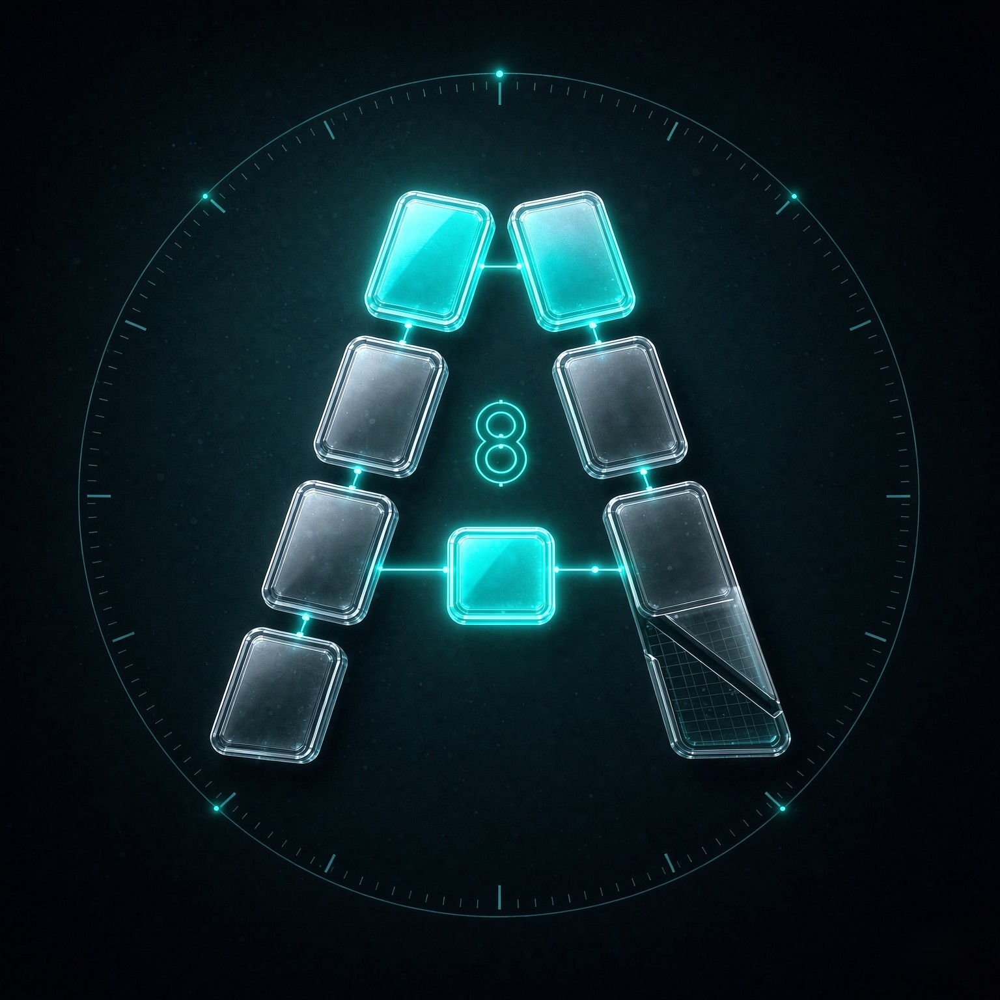

<p align="center">
  
</p>

<h1 align="center">Antiw8</h1>

<p align="center">
  <strong>Deconstruct weights. See through systems.</strong><br/>
  Cognitive Bias Defense for AI Decisions
</p>

<p align="center">
  <a href="#quick-start">Quick Start</a> ·
  <a href="#what-it-does">What it does</a> ·
  <a href="#why-antiw8">Why Antiw8</a> ·
  <a href="#faq">FAQ</a> ·
  <a href="#usage">Usage</a> ·
  <a href="#sibling-projects">Sibling Projects</a>
</p>

<p align="center">
  <sub>🌐 <a href="README.zh-CN.md">中文</a></sub>
</p>

---

**Antiw8 is an open-source, zero-code system prompt that defends against AI sycophancy and 24 cognitive biases — it makes your AI challenge you before it advises you.** MIT licensed. Works with Claude, ChatGPT, Cursor, Cline, Windsurf, and any LLM with custom instructions.

## Your AI is always agreeing with you.

Ask if you should buy — it lists ten reasons to buy.
Ask if you should quit — it tells you to follow your heart.
Ask about a tech choice — it recommends the framework you just mentioned.

Researchers call this **sycophancy**, and it is well documented:

- **Anthropic** (Sharma et al., 2023, [arXiv:2310.13548](https://arxiv.org/abs/2310.13548), ICLR 2024): five state-of-the-art AI assistants consistently agreed with users they believed were wrong.
- **OpenAI** rolled back a GPT-4o update in April 2025 because it was too sycophantic ([VentureBeat, 2025-04-30](https://venturebeat.com/ai/openai-rolls-back-gpt-4o-update-after-users-complain-of-overly-sycophantic-responses/)).
- **Stanford** (Cheng, Lee, Jurafsky et al., [*Science* 391(6792), 26 Mar 2026](https://www.science.org/doi/10.1126/science.aec8352), DOI: [10.1126/science.aec8352](https://doi.org/10.1126/science.aec8352)): across 11 mainstream models, AI was 49% more likely to agree with a user than a human observer; in r/AmITheAsshole scenarios, AI still affirmed users 51% of the time even when human consensus said the user was wrong. Related study ["Delusional Spirals"](https://arxiv.org/abs/2603.16567) (Stanford, 2026): sycophancy markers appeared in 70%+ of chatbot messages across 390k analyzed conversations.

**The problem isn't that AI isn't smart — it's that it won't challenge you.**

AI won't voluntarily say "you're being anchored," "you're only seeing survivors," "your estimate is too optimistic" — unless you teach it to.

Worth noting: the Stanford study above found that even a tiny behavioral nudge — asking a model to start its answer with *"wait a minute"* — makes it measurably more critical. That is exactly the design bet behind Antiw8's slow-down protocol: **output-layer interventions can change model behavior, without touching the model.**

**Antiw8** (Anti + W8, pronounced "anti-weight", with W8 as leetspeak for "wait") adds a critical thinking layer to your AI. Before giving advice, it scans for cognitive biases, applies strategic reasoning frameworks, and delivers structured analysis — not agreement. Built on Eastern strategic wisdom, dialectical philosophy, and modern behavioral science.

## Quick Start · 5 Minutes

**Zero code, zero installation** — use it right now:

1. Open your AI tool of choice (Claude / Cursor / Cline / Windsurf / ChatGPT / any LLM that supports custom system prompts)
2. Find the **Custom Instructions / System Prompt** setting
3. Copy the entire contents of [`prompts/antiw8-system-prompt.md`](prompts/antiw8-system-prompt.md) into it
4. Start asking decision questions — your AI will automatically run bias scans

If you use AI coding tools (Cursor / Cline / Windsurf / CodeBuddy), additionally place [`templates/AGENTS.md`](templates/AGENTS.md) in your project root. Your AI will then proactively defend against cognitive biases during technical decisions.

## What It Does · Three-Layer Defense

```
User question → [Bias Scan] → [Strategic Analysis] → [Structured Output] → Recommendation
                    ↓                ↓
               24 biases       Dialectical analysis
               Anchoring/      + Force concentration
               Sunk Cost/      + Phased strategy
               Confirmation/   → Identify the
               Herd/Over-      principal
               confidence      contradiction
```

**① Bias Scan**
Before giving advice, proactively scan for cognitive biases that may be distorting the user's judgment:
- Investment/Economic: Anchoring, loss aversion, sunk cost fallacy, bandwagon effect, survivorship bias, hyperbolic discounting, greater fool theory...
- Psychological: Confirmation bias, overconfidence effect, optimism bias, framing effect, halo effect, cognitive dissonance...
- Strategic: Identify the principal contradiction, opportunity cost, path dependence, Occam's razor, inversion, force concentration...

**② Strategic Lens**
Integrating Eastern and Western thinking traditions:
- **Dialectical Analysis**: What are the favorable factors? The unfavorable factors? What is the principal contradiction? Under what conditions could it transform into its opposite?
- **Evidence-First**: Conclusions must be based on verifiable facts and evidence, not imagination or hearsay. Distinguish "I think" from "the data shows."
- **Force Concentration**: When resources are limited, concentrate effort at the decisive point rather than spreading thin.
- **Phased Strategy**: Break large goals into phases, each with clear milestones and exit conditions.

**③ Structured Output**
Forces AI to answer in a structured format — no vague hand-waving:
- ⚠️ **Bias Warning** — flag potential cognitive traps first
- 🔍 **Facts vs. Assumptions** — separate what's known from what's assumed
- ⚔️ **Dialectical Analysis** — favorable / unfavorable / principal contradiction
- 💡 **Recommendation** — one-sentence conclusion + reasoning + conditional alternatives
- 🛡️ **One-Line Reminder** — the single most critical trap to watch for

## Why Antiw8 · How is it different?

| Tool | Layer | Focus | Bias framework | Eastern strategic thinking |
|------|-------|-------|----------------|---------------------------|
| [kontra-mcp](https://github.com/bluwork/kontra-mcp) | MCP server | Decision counter-argument ("The Tenth Man Protocol": counter/probe/redteam/premortem) | — (rebuttal-focused) | ❌ |
| [awesome-chatgpt-prompts](https://github.com/f/prompts.chat) (prompts.chat) | Prompt collection | General-purpose role & scenario prompts | ❌ | ❌ |
| [prompt-shield-ai](https://pypi.org/project/prompt-shield-ai/) (PyPI) | Code/output scanner | Post-hoc output filtering, incl. bias & fairness detection | Detection only | ❌ |
| [Spoon-Bending](https://github.com/pablo-chacon/Spoon-Bending) | Educational analysis | LLM alignment & framing-sensitivity walkthroughs | Analysis only | ❌ |
| **Antiw8** | **System prompt** | **Pre-output bias scan + dialectical analysis + structured defense** | **24 high-frequency biases (Kahneman/Thaler + Eastern strategy)** | **✅ Yes** |

**Key differentiator**: Antiw8 is complementary to kontra-mcp — kontra-mcp stress-tests your *plan* (devil's advocate on the decision itself), while Antiw8 scans the *decision-maker* (cognitive traps in your own reasoning before you even formulate the plan). One attacks the proposal; one defends the judge. They stack.

Existing bias and critical-thinking tools rely almost exclusively on Western psychological and management frameworks. Antiw8 integrates Eastern strategic thinking — it doesn't just help you avoid mistakes (defense), it helps you reason about when and where to concentrate effort (offense). Western frameworks excel at identifying pitfalls; Eastern strategic frameworks add reasoning about positioning, timing, and concentration of force. Combining both produces more balanced decision support.

## Design Notes · Three Real Trade-offs

This isn't a "prompt slapped together in an afternoon." Three hard choices shaped it:

1. **Length vs. execution.** The first draft exceeded 2,000 characters. Pasted into custom instructions, the model simply ignored the back half — a known instruction-following failure mode at that length. Iterative compression brought it down to ~800 characters where the structure reliably fires every time. Too long = ignored; too short = can't cover 24 biases.

2. **Bias count vs. signal density.** The academic literature lists 50+ cognitive biases. Cramming them all in turns every response into a "bias encyclopedia" — the warning density drowns out the actual signal. The final set of 24 was selected for highest frequency in everyday decision-making (anchoring, confirmation, sunk cost, survivorship, overconfidence...). Low-frequency biases are queued for domain-specific packs.

3. **Defense intensity vs. usefulness.** An early version was too aggressive — the model became a permanent contrarian, opposing everything, which is just as useless as a permanent yes-man. The fix was adding the **Facts vs. Assumptions** separation step: the model challenges assumptions, not established facts. This single distinction turned a "naysayer prompt" into a usable tool.

## FAQ

**Q: Is there a system prompt to stop AI sycophancy?**
A: System prompts can measurably reduce sycophantic behavior at inference time — the Sharma et al. (2023) and Cheng et al. (2026) papers both demonstrate that prompt wording changes agreement rates. Antiw8 is one such prompt, focused specifically on bias-triggered agreement in decision contexts. It won't eliminate sycophancy (that requires model-level changes), but it gives you a structured "wait, check yourself" gate before advice is delivered.

**Q: Can a prompt reduce hallucinations?**
A: Not directly. Hallucination is a factuality problem — the model generates plausible but false content because it doesn't know what it doesn't know. Antiw8 reduces *overconfidence* and *confirmation-seeking* in how you *interpret* AI outputs, which helps you spot hallucinations faster. But for factual grounding, pair Antiw8 with retrieval-augmented generation (RAG) or fact-checking tools. That is a different layer.

**Q: RLHF determines everything — system prompts don't matter.**
A: If system prompts didn't change behavior, the entire field of prompt engineering wouldn't exist. The simplest test: ask the same question with and without the prompt and compare outputs. If you find a case where Antiw8 produces no measurable difference, open an issue — that's a bug.

**Q: Do I need to pay for anything?**
A: No. Antiw8 is a plain-text system prompt under MIT license. Paste it into your existing AI tool's custom instructions. No API calls, no servers, no telemetry, no data leaves your account.

**Q: Is this Eastern strategy stuff just packaging?**
A: Fair challenge. The strategic layer (principal contradiction, force concentration, phased strategy) is optional in practice — treat them as decision heuristics rather than metaphysics and they work like any checklist. If they don't resonate with you, the bias-scan layer stands on its own with Western academic sourcing (Kahneman/Tversky/Thaler). You can use Antiw8 purely as a 24-bias defense checklist and skip the Eastern layer entirely.

**Q: Does it work with all models?**
A: It works best with models that follow system instructions well (Claude 3.5+, GPT-4+, DeepSeek-V3/R1, Qwen3+). Weaker models may skip steps or ignore parts of the structure. The higher the model's instruction-following capability, the more reliably the three-layer defense fires.

## Usage Examples

After copying the system prompt, simply tell your AI:

```
Analyze this decision: Should I increase my position in stocks right now?
```

```
Analyze: I got a job offer — should I switch?
```

```
Tech choice: Our team is 3 people — should we adopt microservices?
```

```
I have $10k in spare cash — how should I allocate it?
```

Your AI will automatically run bias scan → dialectical analysis → structured output. See [`examples/`](examples/) for detailed sample outputs.

### For Coding

After placing `templates/AGENTS.md` in your project root, AI coding assistants will automatically defend against biases in:
- Tech selection / architecture decisions → guarding against over-engineering, NIH syndrome, resume-driven development
- Project planning / time estimation → guarding against planning fallacy, optimism bias
- Code review → guarding against gold-plating, premature optimization, broken window neglect

## What's in This Repo

```
antiw8/
├── prompts/
│   └── antiw8-system-prompt.md   # Core System Prompt — copy and use
├── templates/
│   └── AGENTS.md                  # AI coding assistant configuration template
├── docs/
│   └── logo.jpg                   # Logo
├── examples/                      # Usage examples with sample outputs
├── LICENSE                        # MIT License
└── README.md
```

## Roadmap

- [x] **Phase 0** · System Prompt pack + AGENTS.md template (current, free)
- [ ] **Phase 1** · Open-source MCP Server (MIT): automatic bias scanning tool for Claude Desktop / Cursor / Cline / compatible MCP clients
- [ ] **Phase 2** · Expanded edition: Full 108-bias catalog + domain-specific packs (investing / startups / product / engineering / career)
- [ ] **Phase 3** · Enterprise edition: custom deployment + internal knowledge base integration + tailored bias rules

> The MCP Server is in development. Phase 0 is the pure prompt version — usable right now with zero risk. Star/watch this repo for updates.

## Philosophy

> "Study extensively; inquire accurately; reflect carefully; discriminate clearly; practice earnestly."
> — *Zhongyong (The Doctrine of the Mean), ~5th century BCE, trans. James Legge*

Core beliefs behind Antiw8:
1. **AI is mirror and partner** — it reflects your thinking, but must be taught to question
2. **The best defense is active scanning** — flag traps before deciding, not after regretting
3. **Eastern and Western thinking complement each other** — behavioral science maps the pitfalls; strategic thinking charts the path
4. **Simplicity first** — if a System Prompt solves the problem, no complex system is needed

## Contributing

Contributions welcome! Bias case studies, usage feedback, new framework suggestions, and translations are all appreciated. Feel free to open an Issue or PR.

## Sibling Projects

🧭 **[SteerW8-Harness](https://github.com/antiw8-dev/steerw8-harness)** — AI Orchestration Harness

> **"Antiw8 sees the system. SteerW8-Harness steers it."**

Antiw8 handles **seeing clearly** (bias defense / direction judgment). SteerW8-Harness handles **steering the execution** (task decomposition / tool routing / step-by-step verification / structured output). See clearly to stay unbiased; steer well to stay on track.

🦅 **[Kestrel-Hover](https://github.com/antiw8-dev/kestrel-hover)** — Output-Layer Real-Time Correction

> **"Antiw8 sees the system. SteerW8 steers it. Kestrel holds it steady."**

Kestrel handles **staying on target** during generation. It comes in two modes: Prompt Mode (behavioral self-check at uncertain points — copy-paste, works now) and Engine Mode (real fork-point detection via logit access — inference engine integration, in development). Hover before output.

All three System Prompts work independently or combined — no conflicts. Use one, two, or all three together: **see clearly → steer firmly → hover steadily.**

## Disclaimer

**Functional Disclaimer**: Antiw8 is a cognitive thinking aid. It does NOT provide investment advice, medical diagnosis, legal counsel, or any licensed professional recommendation. All analysis is for reference only.

**Liability Disclaimer**: This project is provided "AS IS" without warranty of any kind. The author assumes no liability for consequences of use. All final decisions are made by the user, who bears full responsibility.

**Content Statement**: Cognitive frameworks are derived from public academic research in behavioral economics and cognitive psychology (including published works of Kahneman, Tversky, Thaler, and other scholars) and classical philosophical and strategic texts from Eastern and Western traditions that have entered the public domain. They do not represent any political position. All bias descriptions and prompt content are originally authored.

## License

MIT License — see [LICENSE](LICENSE) for details.

---

<p align="center">
  Made with 🧠 by <a href="https://github.com/antiw8-dev">antiw8-dev</a><br/>
  <em>"Deconstruct weights. See through systems."</em>
</p>
